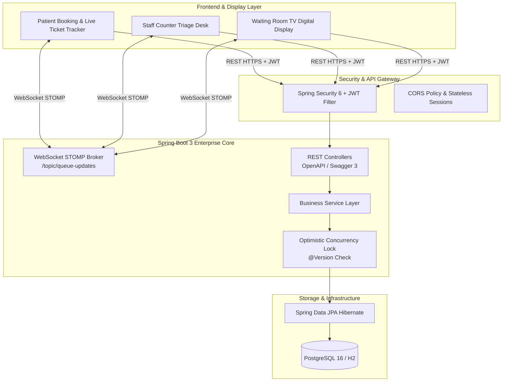

# ⚡ PulseQueue — Real-Time Smart Appointment &amp; Queue Management Platform

[](https://adoptium.net/)
[](https://spring.io/projects/spring-boot)
[](https://www.postgresql.org/)
[](https://www.docker.com/)
[](https://spring.io/guides/gs/messaging-stomp-websocket/)
[](http://localhost:8080/swagger-ui.html)
[](LICENSE)

> Engineered by **[Shakil Jamil Mrida](https://shakiljamil.github.io)** — Senior Software Developer &amp; CSE Graduate (6x AIUB Dean's Award Recipient).

---

## 🎯 Overview &amp; Problem Solved

Traditional appointment systems suffer from two critical architectural pitfalls:
1. **Concurrency Race Conditions:** When two patients attempt to book the exact same time slot at the identical millisecond, naive databases suffer double-booking.
2. **Stale Waiting Room Queues:** Patients sit in anxiety refreshing pages because queue numbers do not update dynamically as doctors call tickets.

**PulseQueue** eliminates both problems:
- **Optimistic Locking (`@Version`):** Enforces strict version checks in PostgreSQL/JPA. Concurrent collision attempts are intercepted and rejected gracefully with a clean `409 Conflict`.
- **Sub-20ms Real-Time Push:** Leverages **Spring WebSocket (STOMP broker)** to broadcast queue advancements instantly across patient mobile screens, staff triage desks, and waiting room TV monitors without polling.

---

## 🏛️ System Architecture



---

## ✨ Key Technical Highlights

- **Concurrency Safety via JPA Optimistic Locking:**
  The `TimeSlot` entity utilizes `@Version private Long version;`. If two simultaneous requests target the same slot, Hibernate detects the version increment collision and throws `ObjectOptimisticLockingFailureException`, which our `@RestControllerAdvice` translates into an actionable user notification.
- **Bi-directional WebSocket Communication:**
  Staff calling next patient (`/api/queue/call`) triggers `SimpMessagingTemplate.convertAndSend("/topic/queue-updates", payload)`, causing patient tracker cards and TV monitors to ring an audio chime and update state in real time.
- **Stateless JWT & Role-Based Access Control (RBAC):**
  Full Spring Security 6 implementation with custom `JwtAuthenticationFilter`, securing endpoints across `ROLE_CUSTOMER`, `ROLE_STAFF`, and `ROLE_ADMIN`.
- **Interactive Documentation:**
  Complete OpenAPI 3 specification accessible live via Swagger UI at `/swagger-ui.html`.
- **Automated Unit & Concurrency Testing:**
  Automated tests utilizing **JUnit 5 & Mockito** testing slot reservation, concurrency collision recovery, and ticket assignment.
- **Containerized 1-Command Deployment:**
  Production-ready multi-stage `Dockerfile` and `docker-compose.yml` orchestrating PostgreSQL and the Spring Boot application with pre-seeded data.

---

## 🖥️ Portals &amp; Views Included

| Portal | Audience | Key Capabilities |
| :--- | :--- | :--- |
| **Booking Engine** | Patients | Filter slots by Department &amp; Date, reserve with optimistic locking, walk-in quick triage. |
| **Live Ticket Tracker** | Patients | Live `# in line` count, dynamic wait-time estimate, assigned counter updates. |
| **Staff Counter Desk** | Doctors &amp; Triage Staff | `Call Next`, `Start Service`, `Complete Consultation`, `Mark No-Show`. |
| **Waiting Room TV Signage** | General Public | High-contrast digital board showing **NOW SERVING** tickets per counter with audio chime. |
| **Throughput Metrics** | Administrators | Live active queues, daily completion rate, average wait time analytics. |

---

## ⚡ Quick Start (Run Locally in 2 Minutes)

### Option 1: Run with Docker Compose (Recommended)
Clone the repository and spin up the complete stack (PostgreSQL + Spring Boot Backend + Frontend):
```bash
git clone https://github.com/ShakilJamil/pulsequeue.git
cd pulsequeue
docker compose up --build
```
Open **[http://localhost:8080](http://localhost:8080)** in your browser!

---

### Option 2: Run with Maven &amp; Java 17
Requirements: Java 17 installed.
```bash
git clone https://github.com/ShakilJamil/pulsequeue.git
cd pulsequeue

# Windows
mvn spring-boot:run

# Linux / macOS
./mvnw spring-boot:run
```
PulseQueue boots instantly using an in-memory **H2 database** pre-seeded with departments, staff, time slots, and queue tickets.

---

## 🔑 Pre-Seeded Demo Credentials

| Role | Email | Password | Pre-configured Access |
| :--- | :--- | :--- | :--- |
| **Admin** | `admin@pulsequeue.dev` | `Admin@123` | Full access, analytics, department configuration |
| **Staff (Doctor)** | `staff1@pulsequeue.dev` | `Staff@123` | Counter 101 station, queue calls, consultations |
| **Staff (Nurse)** | `staff2@pulsequeue.dev` | `Staff@123` | Counter 102 station, triage |
| **Customer** | `customer@pulsequeue.dev` | `Customer@123` | Slot reservation, live queue ticket tracking |

---

## 📡 API Endpoints Reference

| Method | Endpoint | Description | Access |
| :--- | :--- | :--- | :--- |
| `POST` | `/api/auth/register` | Register customer account | Public |
| `POST` | `/api/auth/login` | Obtain stateless JWT token | Public |
| `GET` | `/api/departments` | List all medical departments | Public |
| `GET` | `/api/slots` | Query open slots by date &amp; department | Public |
| `POST` | `/api/appointments/book` | Reserve slot (Guarded with `@Version`) | Customer / Auth |
| `GET` | `/api/appointments/my` | View authenticated user's bookings | Customer / Auth |
| `GET` | `/api/queue/active` | Get active waiting queue tickets | Public |
| `GET` | `/api/queue/serving` | Get currently serving tickets for TV | Public |
| `POST` | `/api/queue/walkin` | Issue immediate walk-in ticket | Public |
| `POST` | `/api/queue/call` | Call next waiting patient to counter | Staff / Admin |
| `POST` | `/api/queue/complete/{id}` | Mark consultation completed | Staff / Admin |
| `GET` | `/api/analytics/live` | Real-time clinic throughput stats | Public |
| `WS` | `/ws-queue` | WebSocket handshake endpoint | Public |
| `SUB` | `/topic/queue-updates` | Real-time queue event broadcast | Public |

Full interactive API docs available at **`http://localhost:8080/swagger-ui.html`**.

---

## 🧪 Running Automated Tests

Run the JUnit 5 test suite covering appointment booking and concurrency collision handling:
```bash
mvn test
```

---

## 👤 Author

**Shakil Jamil Mrida**  
- **Portfolio:** [https://shakiljamil.github.io](https://shakiljamil.github.io)
- **LinkedIn:** [linkedin.com/in/Shakil Jamil Mrida](https://www.linkedin.com/in/Shakil%20Jamil%20Mrida)
- **Email:** [mafialhasan@gmail.com](mailto:mafialhasan@gmail.com)
- **GitHub:** [@ShakilJamil](https://github.com/ShakilJamil)

---

## 📄 License
This project is licensed under the MIT License — see the [LICENSE](LICENSE) file for details.
